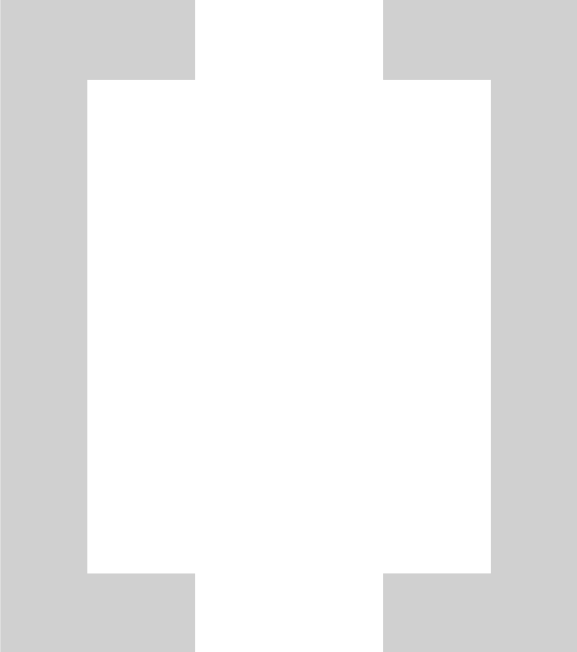

     
    

        
    

    

        search without the noise
         
        <a href="https://clasp.wdkq.cc">
            clasp.wdkq.cc
        </a>
    

### about
сlasp is a small, open-source metasearch engine built with privacy in mind. it doesn't track users or log search queries, and it's ad-free.

### how it works?
сlasp anonymizes your queries before sending them to search engines, then filters and re-ranks the results for you so you get the highest-quality results possible.

we only use search engines that claim to protect your privacy.

### quality of life
we believe quality-of-life features are one of the most important parts of a search engine, so we focus on what could improve your experience. we also strive to make search results as accurate and relevant to your query as possible.

### docs
- [self-hosting](/docs/self-hosting.md)
- [api environment variables](/docs/api-env-variables.md)
- [api documentation](/docs/api.md)
- [contributing guide](/docs/contributing.md)

### licensing
the code is s open source and distributed under the [AGPL-3.0](LICENSE) license. you can always fork the repository, submit a pull request or change it for yourself.
